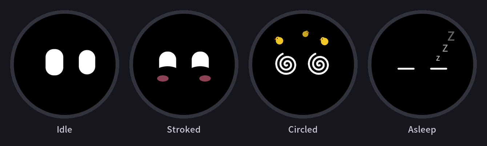
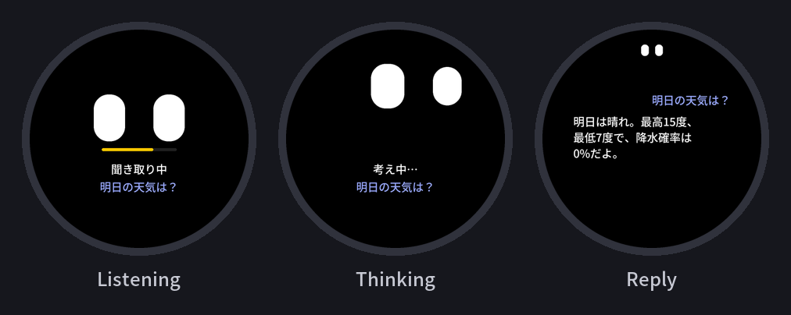

# はじめに

M5Stack StopWatchを買いました。
https://www.switch-science.com/products/11200

何に使おうかも碌に考えずに衝動買いしたのですが、Twitterに流れてきたエージェントのインタフェースとしての使い方が面白そうだったのでやってみることにします（どの投稿だったか後から見つけられずリンクはありません。。。）

勝手に画面が動く系のデジタルキーホルダーとして持ち運びつつ、画面に触るとリアクションがあったり、話しかけるとClaudeと会話できるようにしてみます。

できたのはこんな感じ。
https://x.com/_cityside/status/2120352327983071635

リポジトリも公開しているのでよければ使ってください。
https://github.com/n-yokomachi/m5-stopwatch-avatar

# できること

## 待機中または画面タッチ時に表情を変える

待機中は白い目が2つ表示されていて、ときどきまばたきしたり、きょろきょろしたりします。
画面に触ると指のほうを見てくれるようにしています。
上下左右の端に近づくほど目の大きさを変えるようにしており、ちょっと立体感が出るようにしています。

| アクション | 表情 |
| --- | --- |
| 画面の上のほうを左右になでる | 笑う |
| 画面上をぐるぐるなぞる | 目を回す |
| 本体を激しく振る | 怒る |
| しばらく放っておく | 目を閉じて寝る。時間経過、または画面タッチで起きる |
| 電池が少なくなる | 眠たそうになる |

## Push to Talkで音声入力してClaude Codeセッションで会話

Wi-FiまたはBluetoothでMacに接続されている時には、黄ボタンをホールドすることで音声入力ができるようになっています。STT（Speech to Text）はStopWatchの中ではなく、MacのMLX版Whisper（whisper-small）で行っています。STTは二段階で、ホールドしている間の逐次テキスト化と、ホールドを離した後に録音全体をもう一度テキスト化する処理をしており、後者から誤認識を取り除いた内容がClaude Codeのセッションに送られます。
Claude Codeから返ってきた内容は画面にストリーミング表示されます。

そのほか各ボタンは以下の割り当てとなっています。
電源ボタン単押し：ボタン説明の表示
黄ボタン単押し：会話履歴の表示
青ボタン単押し：新しいセッションの開始
青ボタンホールド：メニューに戻る

## 接続方式

Wi-FiまたはBluetoothでMacBookと接続するようにしています。
家ではWi-Fi経由、外出先でWi-Fiがない場合は自動でBluetooth（BLE）に切り替わります。

## 出荷時のメニューはそのまま

出荷時のメニューを残したまま、そこにアプリケーションを追加する形で作っているため、時計などの元の機能も引き続き使用可能です。

# おしまい

ということで、M5Stack StopWatchでClaude Codeと会話できるアバターアプリを作ってみた紹介でした。
で思ったんですが、これ結構バッテリー消費激しい・・・
一応スリープモードは画面暗くしたりしていますが、もう少し工夫が必要かも
あとデバイス自体の触り心地が結構いい。軽いし、画面も綺麗だし、ボタンもフィジェット的な気持ちよさがあっていい感じです。

